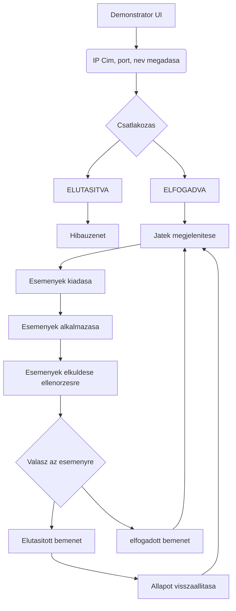
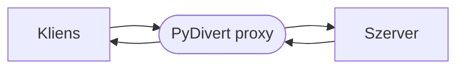

# Kliensoldali előrejelzés és szerverrel történő állapot-egyeztetés többszereplős játékban

## 1. Szereplők és jogosultságok

A projekt elsősorban azt vizsgálja, hogy a megvalósított szinkronizációs technikák, hogyan viselkednek adott hálózati körülményekben. A demonstrátor egy vizualizációs eszközként szolgál, nem különböztet meg felhasználókat a hagyományos értelemben.

| Név        | Igény                                              | Felelősség                                                                                       |
| ---------- | -------------------------------------------------- | ------------------------------------------------------------------------------------------------ |
| Megfigyelő | A szinkronizációs stratégia működésének vizsgálata | Megnyitja a demonstrátort, bemenetekkel változtatja a játékállapotot. Megfigyeli a változásokat. |

## 2. Rendszer komponensei

| Név          | Igény                                                              | Felelősség                                                                                                                                                      |
| ------------ | ------------------------------------------------------------------ | --------------------------------------------------------------------------------------------------------------------------------------------------------------- |
| Demonstrátor | Egyszerű játék, amivel a szinkronizációs eljárásokat vizualizáljuk | Az előrejelzési stratégia működésének vizualizálása. Összehasonlítási szempontot biztosít a két szinkronizációs megoldás között. Állapotegyeztetés a szerverrel |
| Szerver      | Központi játékállapot, amelyhez a játékosok igazodnak              | Klienstől érkező bemenetek fogadása és validálása. Játékállapotban történő változások hirdetése a klienseknek.                                                  |
| Proxy        | Szinkronizációs megoldások működésének vizsgálata                  | Változó hálózati körülmények előállítása                                                                                                                        |

## 2. Use case-k / user storyk

### Szinkronizációs stratégia működésének megfigyelése

**Szereplő:** Megfigyelő

**Előfeltétel:** nincs

**Fő folyamat:**

## 3. Funkcionális követelmények

### Demonstrátor

| Követelmény                                       | Elfogadási kritérium                                                                                                      | Prioritás |
| ------------------------------------------------- | ------------------------------------------------------------------------------------------------------------------------- | --------- |
| Játék megjelenítése                               | A játék bármilyen akadozás nélkül fusson                                                                                  | Kritikus  |
| Előrejelzési stratégia alkalmazása                | A specifikációban leírtak teljes megvalósítása                                                                            | Kritikus  |
| Bemenetek pufferelése                             | A kliens feljegyezni a bemeneteit és elhelyezni a megfelelő batchekben                                                    | Kritikus  |
| Szervertől mérvadó játékállapotához való igazodás | A kliens képes fogadni a szervertől érkező mérvadó állapotot és a szinkronizációs stratégiának megfelelően igazodni hozzá | Kritikus  |
| Bemenetek egyeztetése a szerverrel                | A kliens képes az előállított batcheket továbbítani a szervernek                                                          | Kritikus  |
### Szerver

| Követelmény                        | Elfogadási kritérium                                                                              | Prioritás |
| ---------------------------------- | ------------------------------------------------------------------------------------------------- | --------- |
| Játékállapot kihirdetése           | A szerver az összes kliensnek el tudja küldeni a mérvadó játékállapotot                           | Kritikus  |
| Játékosok bemeneteinek ellenőrzése | A szerver a kliensek összes lehetséges bemenetét képes kezelni                                    | Kritikus  |
| Játékállapot megfelelő tárolása    | A szerver hatékonyan tudja kinyerni a döntéséhez szükséges információkat a tárolt játékállapotból | Kritikus  |
### Proxy

| Követelmény           | Elfogadási kritérium                                                                                 | Prioritás |
| --------------------- | ---------------------------------------------------------------------------------------------------- | --------- |
| Naplózás              | A proxy naplói a későbbi adatelemzés szempontjából kritikusak. Minden információt fel kell jegyeznie | Kritikus  |
| Csomagok késleltetése | Teljes mértékben meg kell valósítania.                                                               | Kritikus  |
| Csomagok eldobása     | Teljes mértékben meg kell valósítania.                                                               | Kritikus  |

## 4. Üzleti szabályok és korlátok

A demonstrátor játékszabályai a következők

| Szabály vagy korlát                | Indoklás                                         |
| ---------------------------------- | ------------------------------------------------ |
| W billentyű lenyomása              | Elfordulási vektorral megfelelő irányba mozgás   |
| S billentyű lenyomása              | Elfordulási vektorral ellentétes irányba mozgás  |
| A billentyű lenyomása              | Balra fordulás                                   |
| D billentyű lenyomása              | Jobbra fordulás                                  |
| Fedezéken nem lehet átlőni/átmenni | Szinkronizációt több szempontból lehet vizsgálni |
## 5. Felhasználói felület és munkafolyamat

A demonstrátornak kettő felhasználói felülete van. 

Az elsővel a felhasználó akkor találkozik amikor elindítja a játékot. Ezen a felületen egy szövegmező, ahol megadja a játékszerver IP címét és a portját a következő formátumban:

**IP:PORT** , például: **192.168.0.10:4949**

Sikeres csatlakozás esetén az első felület eltűnik és megjelenik a játék. Ezen a felületen a játékon kívül meg vannak jelenítve a hálózattal kapcsolatos információk, mint:
- ping
- packet loss (%)
- server tick rate

## 6. Nem funkcionális követelmények

| Követelmény           | Ellenőrzés módja                                                                                                                          |
| --------------------- | ----------------------------------------------------------------------------------------------------------------------------------------- |
| Csalók elleni védelem | Amikor egy játékos csatlakozik a játékhoz a szerver generál neki egy egyedi azonosítót. Minden üzenetében el kell helyeznie ezt a számot. |
| Kompatibilitás        | A rendszer összes komponensét tesztelni kell linux és windows környezetekben                                                              |
| Teljesítmény          | A demonstrátornak biztosítania kell a minimum 60 FPS-t                                                                                    |
## 7. Nyitott kérdések és kockázatok?

| Kérdés / kockázat                                                        | Hatás                                                                      | Felelős  | Feloldás / döntés                                                                                                                                |
| ------------------------------------------------------------------------ | -------------------------------------------------------------------------- | -------- | ------------------------------------------------------------------------------------------------------------------------------------------------ |
| A mérvadó játékállapot kihirdetésére TCP-t vagy UDP-t érdemes használni? | TCP esetén lassabb lenne a kihirdetés, de biztosan megérkeznének az adatok | Hallgató | UDP. Gyorsabb, mint a TCP, timestampek segítségével lehet ellenőrizni, hogy a kapott mérvadó játékállapot releváns-e vagy nem.                   |
| A szerver állapothirdetésnél deltákat vagy teljes állapotot küldjön?     | Teljes állapot esetén nagyobb sávszélesség szükséges                       | Hallgató | Teljes állapotküldés. A delták küldése egy optimalizálási kérdés, nem lesz egyszerre annyi játékos, hogy teljes állapotküldés problémát okozzon. |

## 8. Kezdeti technikai javaslat

### Technológiai irány
| Terület             | Jelölt technológia / megközelítés | Megfontolás oka                                                                                                                                                | Nyitott kérdés / kockázat                                                                          |
| ------------------- | --------------------------------- | -------------------------------------------------------------------------------------------------------------------------------------------------------------- | -------------------------------------------------------------------------------------------------- |
| Demonstrátor        | C++/SFML/boost.asio               | C++ egy alacsonyszintű programozási nyelv, ideális videójátékok készítésére a gyorsasága miatt. Boost segítségével könnyebben lehet kommunikálni a szerverrel. | A memóriakezelésből adódhatnak problémák, de a modern C++ funkcionalitások erre megoldást biztosít |
| Szerver             | C++/boost.asio                    | C++ a gyorsasága miatt, boost pedig tökéletes absztrakciót nyújt a rendszerspecifikus socket programozás felett                                                | A memóriakezelésből léphetnek fel nagyobb problémák                                                |
| Proxy               | Python/PyDivert                   | Egyszerű kezelhetőség                                                                                                                                          | Problémát jelenthet, hogy Linux alapú rendszereken még kísérleti fázisban van.                     |
| Adatok kiértékelése | Python/matplotlib                 | Egyszerű kezelhetőség, diagramokon keresztül a statisztika jobban értelmezhető                                                                                 | A korai fejlesztés alatt helyi SQLite használható.                                                 |

### Architektúra

A hálózati körülmények szimulálását Pythonban fogom végezni a PyDivert könyvtár segítségével. A python program proxyként működne a kliens és a szerver között. A csomagokat, amelyek a szerver portjaira érkeznek, a szimulálandó hálózati körülménynek megfelelően továbbítja/késlelteti/dobja el.

A megoldásomban az Authoritative Server-Client architektúrát alkalmazom. Ebben a szervezési módban a szerver játékállapota a mérvadó állapot, mindenkinek ehhez kell igazítania magát. Ha valamelyik kliens meg szeretné változtatni a szerver állapotát, akkor először el kell küldenie a bemenetét a szervernek. A szerver ellenőrzi a kliens bemenetét majd vagy elfogadja, vagy nem.

### Javasolt megoldás

### 1. A Demonstrátor

A demonstrátor egy kétdimenziós játék, amiben a játékosok harckocsikat irányítanak. A demonstrátorban egyetlen játékmód lehetséges, ami a free-for-all (mindenki mindenki ellen)

A pályát egy bitmap segítségével hozom létre. Megvalósítás szempontjából egy statikus kétdimenziós uint8_t tömb formájában. A bitmap celláinak háromféle típusa van:
- Terep
- Fedezék - olyan terep amin nem lehet átmenni/átlőni
- kilőtt játékos - kilőtt játékosok harckocsija automatikusan fedezék lesz

A harckocsik mozgása összetett.
- W és S billentyűvel az elfordulási vektorral megegyező/ellentétes irányba lehet mozogni.
- A és D billentyűvel a harckocsi testét lehet forgatni. A harckocsi menetiránya megegyezik azzal az iránnyal, amerre a test néz
- A torony mindig a kurzor irányába mutat.

Minden játékos 10 lőszerrel kezdi a játékot. A lövések utáni újratöltési idő 10 másodperc.

### 2. Kliensoldali előrejelzés

A demonstrátor fő feladata, hogy fogadja a klienstől a bemeneteket.

Az előrejelzés során a legelső feladata a kliensnek, hogy kiszűrje az abszolút lehetetlen bemeneteket és azokat eldobja. Például, abszolút lehetetlen bemenet az, ha a játékos lőni próbál, de már kifogyott. Semmi értelme nincs ezt elküldeni a szervernek, mert nincs utánpótlás. A szerver mindenféleképpen elutasítaná.

A következő lépésben a kliens feljegyzi a bementet az erre fenntartott adatstruktúrájában. Adatstruktúra pontosabb leírása lentebb.

Miután feljegyezte a bemenetet, alkalmazza azt a saját játékállapotán.

A kliens bemeneti bufferét egy circular buffer segítségével implementálom. A buffer egy bejegyzése tárolja a bemenet kódját, sequence azonosítóját és batch azonosítóját.

Azok a bemenetek, amiket a kliensnek továbbítania kell:
- W, A, S, D (mozgással kapcsolatos billentyűk) lenyomása
- Olyan akció ami a torony forgatásával jár (egér mozgás)
- Bal egérgomb lenyomása (lövés, újratöltési időzítő elindítása)

Az állapotegyeztetés menete:
- A kliens fogadja a szervertől a mérvadó állapotot
- Ha az adat egy, a klienstől független játékbeli objektum mozgása (ellenséges tank, lövedék) :
	- Az üzenetből kinyerni az objektum frissített információit
	- Az objektum előző állapotát elmenteni egy átmeneti tárolóhelyben
	- A friss állapotot elhelyezi az objektum adatstruktúrájában
	- A gameloopban a megfelelő frissítési eljárással megjeleníteni az objektumot
- Ha az adat a kliensre utal:
	- Ha a szerver megtagadja az egyik batchet, akkor az összes azutánit invalidálnia kell
		- Az üzenet adatrészében kiküldött játékállapothoz azonnal igazítania magát
	- Ha a szerver engedélyezi a bemenetet, akkor a bemeneteket tároló adatstruktúrát frissíti

**Példa az állapotegyeztetésre:**

Adott egy ellenséges tank az alábbi koordinátákkal: (90;100)
Adott egy frissítés a tank új pozíciójáról: (91;100)

Az állapotegyeztetés menete:
1. A régi és az új koordináták segítségével elmozdulási vektor készítése
2. Ha a tank mozgatására használt vektor elfordulási szöge nem egyezik meg az új elmozdulási vektorral, akkor azt az utóbbihoz igazítja
3. Meghatározni, hogy hányszor kell használni az új vektort, hogy az új pozícióba kerüljön az objektum
4. Az objektum mozgatása az új pozíciója felé
5. Az objektum megjelenítése az új paraméterei szerint

### 3. Szerver

A szerver felelőssége az, hogy a kliensektől érkező adatokat (mozgás, lövés, stb) ellenőrizze, ha lehetséges alkalmazza. Az ellenőrzés során feltett legfontosabb kérdések:

- "A játékos végrehajthatja ezt az akciót?"
- "Ez az akció milyen hatással lesz a többi játékosra?"

A kliens és a szerver egy egyszerű protokoll segítségével kommunikálnak egymással, amely az OSI modellben az application layerben helyezkedik el.

A szerver és a kliens az üzenetváltásaikra két portot használnak. A kliens a bemenetek eljuttatására TCP-t használ. A kliens a mérvadó állapot kihirdetésére UDP-t használ. A szerver amikor a mérvadó állapotot hirdeti mindig a teljes állapotot küldi el a klienseknek.

A szerver további feladata az, hogy az olyan eseményekről is tájékoztassa a klienst, amelyet nem ő adott állított elő, mint például egy másik játékos mozgása vagy lövése. Tehát a szerver az alábbi állapotokat is továbbítja:

- Kilőtt lőszer: Pozíciója
- Találat esetén: csökkentett életerő
- Ellenség mozgása esetén: új játékos pozíció/elforgatás
- Játékos kilövése esetén: a frissített pálya

A szerver és a kliens állapotegyeztetése batchek segítségével történik. A kliens fix időközönként küldi el a batcheket, ami tartalmazza a feljegyzett bemeneteit és a sequence numbert. A szerver a válaszában megadja a batch azonosítóját, illetve azt, hogy mely bemeneteket ismerte el. Ha egy bemenetet elutasított, akkor az utána következő összes bemenetet a kliensnek elutasítottként kell kezelnie és le kell kérdeznie a játékállapotot.

### 4. Egyszerű protokoll leírása

A kliens és a szerver kommunikációja három fázisból áll.
1. Fázis - Csatlakozás:
	- A kliens:
		- Elhelyezi a MSGTYPE mezőben a CONNREQ flaget
		- A timestamp mezőben az aktuális idejét
	- A szerver:
		- Generál a kliensnek egy egyedi azonosítót és elhelyezi a megfelelő adatstruktúrájában a kliensről az információt
		- Generál egy 32 bites számot, ami azt adja meg, hogy a kliens honnan kezdje a csomagjainak a számozását
		- Beállítja a MSGTYPE mezőben a CONNACK flaget
		- Ha nem tudja fogadni a klienst, akkor CONNDENY flaget
	- A kliens:
		- Ha a MSGTYPE mezőben CONNACK flaget lát, akkor kiolvassa a szerver által kiküldött adminisztratív információkat
		- Egy SYN üzenettel lekéri az aktuális játékállapotot
	
2. Fázis - Játék
	
	Kétféle kommunikáció lehetséges: Validálás, Hirdetés
	
	**Validálás:
	- Kliens:
		- A MSGTYPE mezőben elhelyezi a VALIDATE flaget
		- A timestamp mezőben az aktuális időt
		- A batch id mezőben elhelyezi az aktuális batch idt
		- Az adatmezőben a batch tartalmát
	- Szerver:
		- Fogadja a VALIDATE üzenetet
		- Végigmegy a bemeneteken, ellenőrzi, hogy végrehajtható-e az adott bemenet
		- Ha minden bemenet vérehajtható, akkor kihirdeti az állapotot
		- Ha nem, akkor elhelyezi a MSGTYPE mezőben a DENY flaget, a batch id mezőben a megtagadott batch azonosítóját
	
	 **Kihirdetés:
	- Szerver:
		- A MSGTYPE mezőben elhelyezi a STATE flaget
		- A timestamp mezőben az aktuális időt
		- Az adatmezőben a teljes játékállapotot
	
3. Fázis - Kilépés
	A kliens:
	- Elhelyezi a MSGTYPE mezőben az EXIT flaget
	- Elküldi a szervernek
	A szerver:
	- Elhelyezi a MSGTYPE mezőben az ACK_EXIT flaget

### 5. Szinkronizációs technika

A szinkronizációs technikára interpolációt valósítanék meg. A demonstrátor egyszerűsége miatt ez a szinkronizációs technika bizonyul a leghatékonyabbnak. Az esetek nagy részében olyan dolgokat kell szinkronizálni, amit a felhasználó lát. Például az ellenfél mozgása vagy egy kilőtt lőszer helyzete a pályán. Interpoláció és a szinkronizációs üzenetekben megkapott koordináták és elfordulási szögek segítségével könnyen tudnám mozgatni az objektumokat a megfelelő irányba.

Másik érv az interpoláció mellett az, hogy az objektumok mindig egyenes vonalú egyenletes mozgást végeznek. A tankok/lőszerek nem fognak őrült kanyarokat tenni a pályán, a mozgásuk mindig tökéletesen szimulálható.

### 6. Proxy

A proxy fő feladata, hogy a szimulációnak megfelelő hálózati körülményt állítsa elő. A kísérletek során a legfőbb kapcsolati jellemzőket (ping, packet loss) állítanám három fokozat szerint (alacsony, közepes, magas). Továbbá ezeket a jellemzőket együttesen is használnám eltérő vagy megegyező erősségben. 

A proxy további felelőssége a naplók gyártása. A szimulációk során a kliens, a szerver és a pydivert proxy által generált logokból nyerném ki a szükséges adatokat. A logok CSV formátumban lennének. A tárolásuk
egy hierarchikus mintát követnének, ahol minden kísérletnek külön mappája van, azokban pedig a rendszer részeinek a logfájljai (pl.: pydivert.csv). A CSV fájl tartalma mindig az adott kísérlet céljától függ.

A projekt témája miatt fellépő mérési problémák nagyrésze arra keres választ, hogy a rendszer milyen gyorsan tud reagálni a bemenetre, milyen gyakran kell korrigálnia a kliensnek az állapotát, egy kiesés esetén milyen mértékben szakad el a kliens a szervertől és milyen gyorsan tudja magát visszaállítani.

A fő mérőszámok, amiket vezetni kell, mert befolyásolják a rendszert:
- ping
- packet loss

### 7. Egyszerű szinkronizációs megoldás

Az egyszerű szinkronizációs megoldás a következő módon működik:
- A kliens egyből alkalmazza a bemenetet a saját oldalán
- A bemenetet elhelyezi egy batchben
- Elküldi a batchet a szervernek
- A szervertől érkező bemenethez azonnal alkalmazkodik, interpoláció nélkül

### 8. Kísérletek

A kísérletek során a hálózati körülmények hatását fogom nézni a rendszerre. Többféle késleltetési stratégiát fogok alkalmazni. Először elvégezném az alábbi kísérleteket mindkét megközelítés esetén.

Egy kísérletsorozat során megvizsgálnám, hogy a rendszer hogyan viselkedik az egyes késleltetési szinteken, ahol
- alacsony: 10 ± 5 ms
- közepes: 50 ± 5ms
- magas: 100+ ms

Továbbá megvizsgálnám, hogy a rendszer milyen késleltetés felett lesz teljesen használhatatlan.

Egy következő kísérletsorozat segítségével megvizsgálnám azt, hogyan változik a rendszer, ha folyamatosan növelve van a késleltetés. Tehát a késleltetés elindul 10ms- ról és növekedne 200ms-ig.

További kísérletekben előállítanék véletlenszerű késleltetést és csomagvesztést.

Az utolsó kísérlettel a rendszer viselkedését vizsgálnám késleltetésingadozás esetén. Kiválasztanék egy minimum és egy maximum késleltetési értéket. A pydivert proxy elindulna a minimum értékről, növelné egészen maximumig, majd hirtelen visszaesne a minimumra. Ezzel azt vizsgálnám, hogy egy esetleges hálózati torlódás lezajlása után a
rendszer milyen gyorsan tudna normális állapotba visszaállni.